# NextGig data model (Cloud Firestore)

Member 3 owns this file. **Field names are frozen once agreed** - the ERD in the report
must match Firestore exactly, so nobody adds a field without updating this file.

## Entity-relationship diagram

```mermaid
erDiagram
    USERS ||--o{ SKILLS : "owns (subcollection)"
    SKILLS ||--o{ ENDORSEMENTS : "receives (subcollection)"
    USERS ||--o{ ENDORSEMENTS : "gives (endorserId)"
    USERS ||--o{ EARNINGS : "records (subcollection)"
    USERS ||--o{ NOTIFICATIONS : "receives (subcollection)"
    USERS ||--o{ BOOKMARKS : "saves (subcollection)"
    GIGS ||--o{ BOOKMARKS : "saved as (doc id = gigId)"
    USERS ||--o{ GIGS : "posts (posterId)"
    GIGS ||--o{ APPLICATIONS : "receives (gigId)"
    USERS ||--o{ APPLICATIONS : "applies (applicantId)"
    APPLICATIONS ||--o| REVIEWS : "reviewed once (doc id = application id)"
    USERS ||--o{ REVIEWS : "writes and receives (reviewerId, revieweeId)"
    GIGS |o--o{ EARNINGS : "paid for (gigId, optional)"
    USERS }|--o{ CONVERSATIONS : "takes part in (participantIds, exactly 2)"
    CONVERSATIONS ||--o{ MESSAGES : "contains (subcollection)"
    USERS ||--o{ MESSAGES : "sends (senderId)"
    GIGS |o--o{ CONVERSATIONS : "started from (gigId, optional)"
    USERS ||--o{ MENTORSHIP_REQUESTS : "sends (talentId)"
    GIGS ||--o{ MENTORSHIP_REQUESTS : "about (gigId, matches the gig mentorName)"

    USERS {
        string uid PK "Firebase Auth uid"
        string name
        string email
        string phone
        string role "talent or mentor"
        string bio
        string photoUrl "Cloudinary URL"
        string location "Kigali neighborhood, optional"
        string cvUrl "Firebase Storage URL, optional"
        string cvName "original file name"
        timestamp createdAt
    }
    SKILLS {
        string skillId PK "auto id"
        string ownerUid FK "parent users uid"
        string name
        string proficiency "beginner, intermediate, advanced"
        array portfolio "list of title, imageUrl, link"
        string proofUrl "Firebase Storage URL"
        string proofStoragePath
        bool verified "true only after an endorsement"
    }
    ENDORSEMENTS {
        string endorserId PK "doc id = endorser uid, FK users"
        string endorserName
        string relationship "mentor, lecturer, client"
        string note
        timestamp createdAt
    }
    EARNINGS {
        string earningId PK "auto id"
        number amount "RWF, recorded only"
        string gigTitle
        string gigId FK "optional, gigs"
        string mobileMoneyRef "MoMo or Airtel reference"
        timestamp createdAt
    }
    BOOKMARKS {
        string gigId PK "doc id = gig id, FK gigs"
        timestamp createdAt
    }
    NOTIFICATIONS {
        string notificationId PK "auto id"
        string userId FK "recipient, users"
        string senderId FK "users"
        string type "application, message, match, payment, system"
        string title
        string body
        string gigId FK "optional, gigs"
        bool isRead
        timestamp createdAt
    }
    GIGS {
        string gigId PK "auto id"
        string title
        string description
        string category
        string neighborhood
        number pay "RWF"
        array requiredSkills
        string posterName
        string posterId FK "users"
        string duration
        string level
        number applicantCount
        bool verifiedClient
        bool escrowFunded "recorded status only"
        array deliverables
        string mentorName "optional"
        string imageUrl "optional, Cloudinary URL"
        timestamp deadline "optional"
        timestamp createdAt
    }
    APPLICATIONS {
        string applicationId PK "auto id"
        string gigId FK "gigs"
        string gigTitle "copied from the gig"
        string applicantId FK "users"
        string applicantName
        string posterId FK "users, equals the gig posterId"
        string status "applied, shortlisted, hired, completed, declined"
        timestamp createdAt
    }
    REVIEWS {
        string reviewId PK "same as applicationId"
        string applicationId FK "applications"
        string gigId FK "gigs"
        string reviewerId FK "users, the poster"
        string revieweeId FK "users, the applicant"
        number rating "1 to 5"
        string comment
        timestamp createdAt
    }
    CONVERSATIONS {
        string conversationId PK "sorted uids joined by _"
        array participantIds FK "exactly 2 users"
        map participantNames "uid to display name"
        string gigId FK "optional, gigs"
        string gigTitle "optional"
        string lastMessageText "preview, max 120 chars"
        timestamp lastMessageAt
        timestamp createdAt
        timestamp updatedAt
    }
    MESSAGES {
        string messageId PK "auto id"
        string senderId FK "users, a participant"
        string text "1 to 2000 chars"
        timestamp createdAt
    }
    MENTORSHIP_REQUESTS {
        string requestId PK "auto id"
        string talentId FK "users, the sender"
        string talentName
        string mentorName "as stored on the gig"
        string gigId FK "gigs"
        string gigTitle
        string message "1 to 500 chars"
        string status "pending or cancelled"
        timestamp createdAt
        timestamp updatedAt
    }
```

## Collections

### users/{uid}
| Field | Type | Notes |
|---|---|---|
| (doc id) | string | **PK**, Firebase Auth uid |
| name | string | |
| email | string | |
| phone | string | |
| role | string | `talent` or `mentor`, chosen at sign-up and cannot change |
| bio | string | |
| photoUrl | string | Cloudinary URL |
| location | string | Kigali neighborhood from AppConstants.neighborhoods, optional |
| cvUrl | string | download URL of `cvs/{uid}/cv.pdf` in Firebase Storage; empty = no CV |
| cvName | string | original file name of the CV, shown on the profile |
| createdAt | timestamp | server timestamp |

### users/{uid}/skills/{skillId}
| Field | Type | Notes |
|---|---|---|
| (doc id) | string | **PK**, auto id; the parent `uid` is the owner (**FK** to users) |
| name | string | |
| proficiency | string | `beginner`, `intermediate` or `advanced` |
| portfolio | array<{title, imageUrl, link}> | imageUrl is a Cloudinary URL |
| proofUrl | string | Firebase Storage download URL, optional |
| proofStoragePath | string | `proofs/{uid}/{skillId}/{fileName}` |
| verified | bool | created `false`; only an endorsement can set it to `true` |

### users/{uid}/skills/{skillId}/endorsements/{endorserId}
| Field | Type | Notes |
|---|---|---|
| (doc id) | string | **PK** and **FK** to users: the endorser's uid, so one endorsement per person |
| endorserId | string | same as the doc id; cannot be the skill owner |
| endorserName | string | |
| relationship | string | `mentor`, `lecturer` or `client` |
| note | string | |
| createdAt | timestamp | |

### users/{uid}/earnings/{earningId}
| Field | Type | Notes |
|---|---|---|
| (doc id) | string | **PK**, auto id |
| amount | number | RWF, recorded only (no live payment) |
| gigTitle | string | |
| gigId | string | **FK** to gigs, optional |
| mobileMoneyRef | string | MoMo or Airtel reference |
| createdAt | timestamp | |

### users/{uid}/bookmarks/{gigId}
| Field | Type | Notes |
|---|---|---|
| (doc id) | string | **PK** and **FK** to gigs: the saved gig's id, so a gig is saved at most once |
| gigId | string | same as the doc id |
| createdAt | timestamp | |

### users/{uid}/notifications/{notificationId}
| Field | Type | Notes |
|---|---|---|
| (doc id) | string | **PK**, auto id |
| userId | string | **FK** to users, the recipient (same as the parent uid) |
| senderId | string | **FK** to users, the signed-in sender |
| type | string | `application`, `message`, `match`, `payment` or `system` |
| title | string | |
| body | string | |
| gigId | string | **FK** to gigs, optional |
| isRead | bool | created `false`; only the recipient can change it |
| createdAt | timestamp | |

### gigs/{gigId}
| Field | Type | Notes |
|---|---|---|
| (doc id) | string | **PK**, auto id |
| title | string | |
| description | string | |
| category | string | one of AppConstants.gigCategories |
| neighborhood | string | one of AppConstants.neighborhoods |
| pay | number | RWF |
| requiredSkills | array<string> | used for "Recommended for you" matching |
| posterName | string | |
| posterId | string | **FK** to users; cannot change after creation |
| duration | string | e.g. "2 weeks"; empty = flexible |
| level | string | e.g. "Jr / Mid"; empty = any |
| applicantCount | number | default 0 |
| verifiedClient | bool | default false |
| escrowFunded | bool | recorded status only |
| deliverables | array<string> | |
| mentorName | string | optional |
| imageUrl | string | optional, Cloudinary URL |
| deadline | timestamp | optional |
| createdAt | timestamp | set once on create; the feed is ordered by it |

### applications/{applicationId}
| Field | Type | Notes |
|---|---|---|
| (doc id) | string | **PK**, auto id |
| gigId | string | **FK** to gigs |
| gigTitle | string | copied so lists do not re-read the gig |
| applicantId | string | **FK** to users |
| applicantName | string | |
| posterId | string | **FK** to users; must equal the gig's posterId |
| status | string | `applied`, `shortlisted`, `hired`, `completed` or `declined` |
| createdAt | timestamp | |

### reviews/{reviewId}
| Field | Type | Notes |
|---|---|---|
| (doc id) | string | **PK**, same as the application id, so one review per application |
| gigId | string | **FK** to gigs |
| applicationId | string | **FK** to applications |
| reviewerId | string | **FK** to users, the poster |
| revieweeId | string | **FK** to users, the applicant |
| rating | number | 1 to 5 |
| comment | string | |
| createdAt | timestamp | |

### conversations/{conversationId}
| Field | Type | Notes |
|---|---|---|
| (doc id) | string | **PK**, the two participants' uids sorted and joined by `_`, so each pair has one chat |
| participantIds | array<string> | **FK** to users, exactly 2 different uids |
| participantNames | map<uid, string> | copied in when the chat starts, so the list does not load every profile |
| gigId | string | **FK** to gigs, optional: the gig the chat started from |
| gigTitle | string | optional |
| lastMessageText | string | preview for the chat list, max 120 characters |
| lastMessageAt | timestamp | null until the first message; the list is sorted by it |
| createdAt | timestamp | |
| updatedAt | timestamp | |

### conversations/{conversationId}/messages/{messageId}
| Field | Type | Notes |
|---|---|---|
| (doc id) | string | **PK**, auto id |
| senderId | string | **FK** to users; must be the signed-in participant |
| text | string | 1 to 2000 characters; never edited or deleted |
| createdAt | timestamp | server timestamp; messages are ordered by it |

### mentorshipRequests/{requestId}
| Field | Type | Notes |
|---|---|---|
| (doc id) | string | **PK**, auto id |
| talentId | string | **FK** to users, the talent who asked; only they can read, cancel or delete it |
| talentName | string | |
| mentorName | string | exactly as stored on the gig, e.g. "David Mugisha (Senior Creative Lead)"; must match the gig |
| gigId | string | **FK** to gigs |
| gigTitle | string | copied so the list does not re-read the gig |
| message | string | 1 to 500 characters |
| status | string | `pending`, or `cancelled` by the talent |
| createdAt | timestamp | |
| updatedAt | timestamp | |

Mentors are not a separate collection: the dashboard groups open gigs by their `mentorName`.

## Relationships
| Relationship | Cardinality | How it is stored |
|---|---|---|
| user → skills | 1 to many | subcollection `users/{uid}/skills` |
| skill → endorsements | 1 to many | subcollection, doc id = endorser uid |
| user → endorsements given | 1 to many | `endorserId` |
| user → earnings | 1 to many | subcollection `users/{uid}/earnings` |
| user → bookmarks | 1 to many | subcollection `users/{uid}/bookmarks`, doc id = gig id |
| user → notifications | 1 to many | subcollection `users/{uid}/notifications`, `senderId` links the sender |
| user → gigs posted | 1 to many | `gigs.posterId` |
| gig → applications | 1 to many | `applications.gigId` |
| user → applications | 1 to many | `applications.applicantId` |
| application → review | 1 to 0..1 | review doc id = application id |
| user → reviews written and received | 1 to many | `reviewerId` / `revieweeId` |
| users ↔ conversations | many to many (2 per chat) | `conversations.participantIds` |
| conversation → messages | 1 to many | subcollection `conversations/{id}/messages` |
| user → messages sent | 1 to many | `messages.senderId` |
| gig → conversations | 1 to many, optional | `conversations.gigId` |
| user → mentorship requests | 1 to many | `mentorshipRequests.talentId` |
| gig → mentorship requests | 1 to many | `mentorshipRequests.gigId` |

## Firebase Storage
| Path | Contents | Access |
|---|---|---|
| `proofs/{uid}/{skillId}/{fileName}` | certificate or portfolio proof | signed-in users read; only the owner writes; max 5 MB |
| `cvs/{uid}/cv.pdf` | the user's CV, one per user | signed-in users read; only the owner uploads (PDF, max 5 MB) or deletes |

## Stored on the device, not in Firestore
| Data | Where |
|---|---|
| theme, language (`en` / `rw`), preferred gig category | SharedPreferences |

## Composite indexes (firestore.indexes.json)
| Collection | Fields | Used by |
|---|---|---|
| gigs | posterId ↑, createdAt ↓ | a poster's own gigs |
| applications | applicantId ↑, createdAt ↓ | "My applications" |
| applications | gigId ↑, createdAt ↓ | kept for older builds |
| applications | gigId ↑, applicantId ↑ | duplicate-application check |
| applications | gigId ↑, posterId ↑, createdAt ↓ | the poster sees a gig's applicants |
| applications | gigId ↑, applicantId ↑, createdAt ↓ | an applicant sees their own application on a gig |
| reviews | revieweeId ↑, createdAt ↓ | reviews on a profile |
